# Mapa de las 52 misiones

Las flechas representan las continuaciones disponibles según decisiones o resultados. Las dos salidas de No Clearance incluyen la retirada desde el briefing. Ver RESEARCH.md para las condiciones y sus simplificaciones.

```mermaid
flowchart TD
  m01["1 · Awakening"]
  m02["2 · Bravado"]
  m03["3 · Enter Dision"]
  m04["4 · Paper Tiger"]
  m05["5 · Broken Truce"]
  m06["6 · Ghosts of the Past"]
  m07["7 · No Clearance"]
  m08["8 · Fragile Cargo"]
  m09["9 · Scylla and Charybdis"]
  m10["10 · Fates Intertwined"]
  m11["11 · Reaching for Stars"]
  m12["12 · One-Way Ticket"]
  m13["13 · Bug Hunt"]
  m14["14 · Pawns in the Game"]
  m15["15 · Damage Control"]
  m16["16 · Broken Wings"]
  m17["17 · Sphyrna"]
  m18["18 · A Canopy of Stars"]
  m19["19 · Soldier of Fortune"]
  m20["20 · Megafloat"]
  m21["21 · Target Acquisition"]
  m22["22 · Partners"]
  m23["23 · Tainted Peace"]
  m24["24 · Stratosphere"]
  m25["25 · Welcoming Committee"]
  m26["26 · Technology Transfer"]
  m27["27 · Claustrophobia"]
  m28["28 · Dilemma"]
  m29["29 · Betrayal"]
  m30["30 · Heart of the Serpent"]
  m31["31 · Geofront Attack"]
  m32["32 · Casualties of War"]
  m33["33 · Geopelia"]
  m34["34 · The Orientation"]
  m35["35 · Liquidation"]
  m36["36 · Archnemesis"]
  m37["37 · Memory Error"]
  m38["38 · Electrosphere"]
  m39["39 · Power for Life"]
  m40["40 · Guardian Angel"]
  m41["41 · Zero Gravity"]
  m42["42 · The Prize"]
  m43["43 · Utopian Dreams"]
  m44["44 · Reality Distortion"]
  m45["45 · Counterrevolution"]
  m46["46 · Pursuit"]
  m47["47 · Self Awareness"]
  m48["48 · Resistance"]
  m49["49 · Radio Silence"]
  m50["50 · Revenge"]
  m51["51 · Tunnel Vision"]
  m52["52 · Sole Survivor"]
  m01 --> m02
  m02 --> m03
  m03 --> m04
  m04 --> m05
  m04 --> m19
  m05 --> m06
  m06 --> m07
  m06 --> m08
  m07 --> m09
  m07 --> m08
  m08 --> m09
  m09 --> m10
  m09 --> m39
  m10 --> m11
  m11 --> m12
  m12 --> m13
  m13 --> m14
  m14 --> m15
  m15 --> m16
  m16 --> m17
  m17 --> m18
  m19 --> m20
  m20 --> m21
  m20 --> m22
  m21 --> m23
  m22 --> m23
  m23 --> m24
  m24 --> m25
  m24 --> m26
  m25 --> m27
  m26 --> m28
  m27 --> m28
  m28 --> m29
  m28 --> m34
  m29 --> m30
  m30 --> m31
  m30 --> m32
  m31 --> m32
  m32 --> m33
  m34 --> m35
  m34 --> m36
  m35 --> m36
  m36 --> m37
  m37 --> m38
  m39 --> m40
  m39 --> m41
  m40 --> m42
  m41 --> m43
  m42 --> m43
  m43 --> m44
  m43 --> m48
  m44 --> m45
  m45 --> m46
  m46 --> m47
  m48 --> m49
  m48 --> m50
  m49 --> m50
  m50 --> m51
  m51 --> m52
  m18 --> ending_upeo(["UPEO · Erich y Rena"])
  m33 --> ending_general(["General Resource · Keith"])
  m38 --> ending_dision(["Ouroboros · Dision"])
  m47 --> ending_cynthia(["Ouroboros · Cynthia"])
  m52 --> ending_fiona(["Neucom · Fiona"])
```

